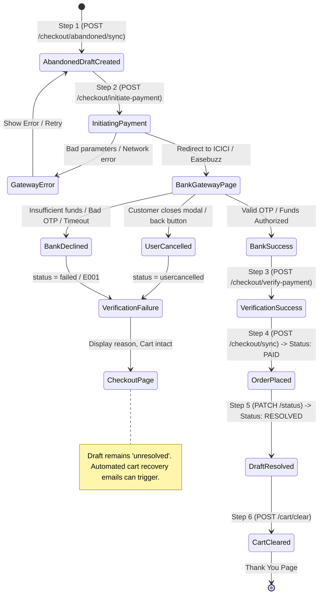

# Comprehensive E-Commerce Checkout to Order Complete & Failure Flow Guide

> **Store Implementation Reference Guide**  
> Complete technical documentation of the checkout lifecycle, state machines, payment gateway workflows (ICICI, Easebuzz, Razorpay, COD), success/failure branches, and copy-pasteable **cURL commands** for integrating and testing any store backend.

---

## Table of Contents
1. [Architecture & Flow Overview](#1-architecture--flow-overview)
2. [Global Configuration & Authentication Headers](#2-global-configuration--authentication-headers)
3. [Step-by-Step Checkout Lifecycle](#3-step-by-step-checkout-lifecycle)
4. [Phase 0: Cart Management (Optional / Pre-Checkout)](#4-phase-0-cart-management)
5. [Phase 1: Pre-Checkout Calculations (Pincode, Shipping, Coupon, Gateways)](#5-phase-1-pre-checkout-calculations)
6. [Phase 2: Abandoned Checkout Session Sync (Draft Order)](#6-phase-2-abandoned-checkout-session-sync)
7. [Phase 3: Payment Gateway Initiation (ICICI, Easebuzz, Razorpay, COD)](#7-phase-3-payment-gateway-initiation)
8. [Phase 4: Payment Verification & Callbacks (Success & Failure Handling)](#8-phase-4-payment-verification--callbacks)
9. [Phase 5: Official Final Order Synchronization (`/checkout/sync`)](#9-phase-5-official-final-order-synchronization)
10. [Phase 6: Abandoned Status Resolution (`PATCH /checkout/abandoned/status`)](#10-phase-6-abandoned-status-resolution)
11. [Phase 7: Post-Order Cart Clear & Order Tracking](#11-phase-7-post-order-cart-clear--order-tracking)
12. [Order Failure & Abandonment Flow](#12-order-failure--abandonment-flow)
13. [Complete cURL Cheat Sheet (All Endpoints)](#13-complete-curl-cheat-sheet)

---

## 1. Architecture & Flow Overview

The checkout architecture follows a resilient **Dual-Stage Order Pattern**:
1. **Abandoned Draft Stage (`/checkout/abandoned/sync`)**: As soon as customer contact or shipping details are entered, a draft record is created. This ensures zero lost orders even if the user drops off, loses connection, or cancels during payment.
2. **Payment Stage (`/checkout/initiate-payment` & `/checkout/verify-payment`)**: Bridges with gateways (ICICI Bank Eazypay, Easebuzz, Razorpay) or processes COD.
3. **Official Confirmation Stage (`/checkout/sync`)**: Upon successful payment verification or COD placement, the draft ID is converted into an official confirmed order (`#ORD-XXXX`), and the draft status is marked as `resolved`.

```mermaid
flowchart TD
    A["Customer Enters Checkout"] --> B["Enter Address & PIN Code"]
    B --> C["Fetch Shipping Rates & Validate Coupon"]
    C --> D["Auto-Sync Abandoned Draft (POST /checkout/abandoned/sync)"]
    D --> E{"Select Payment Method"}

    %% COD Path
    E -->|Cash on Delivery (COD)| F["Final Order Sync (POST /checkout/sync)<br/>status: pending"]
    F --> G["Resolve Abandoned Draft (PATCH /status)<br/>recovery_status: resolved"]
    G --> H["Clear Cart (POST /cart/clear)"]
    H --> I["Order Confirmed (Success Page)"]

    %% Online Gateway Path
    E -->|Online Payment (ICICI / Easebuzz / Razorpay)| J["Initiate Payment (POST /checkout/initiate-payment)"]
    J --> K["Customer Completes Bank / Gateway Step"]
    K --> L{"Gateway Response Status"}

    %% Failure Branch
    L -->|Failed / Cancelled / Hash Mismatch| M["Payment Verification Fails or Aborted"]
    M --> N["Draft remains as Abandoned Order<br/>User redirected to Checkout with Error"]
    
    %% Success Branch
    L -->|Success (E000 / success)| O["Verify Payment (POST /checkout/verify-payment)"]
    O -->|Signature Verified| P["Final Order Sync (POST /checkout/sync)<br/>status: paid"]
    P --> Q["Resolve Abandoned Draft (PATCH /status)<br/>recovery_status: resolved"]
    Q --> R["Clear Cart (POST /cart/clear)"]
    R --> S["Order Confirmed (Success Page & Analytics)"]
```

---

## 2. Global Configuration & Authentication Headers

Every store frontend must communicate with the backend using these standardized headers:

| Header Name | Type | Description | Mandatory |
|:---|:---|:---|:---|
| `X-Shopfront-Token` | `string` | The API shopfront authentication key for the store | **Yes** (All requests) |
| `Content-Type` | `string` | `application/json` | **Yes** (For POST/PATCH) |
| `Accept` | `string` | `application/json` | **Yes** |
| `Authorization` | `string` | `Bearer <JWT_TOKEN>` of logged-in customer | Optional (Logged-in only) |
| `X-Cart-Token` | `string` | Unique guest/session cart token (`cart_<rand>_<ts>`) | Required for cart APIs |

### Environment Variables
```env
API_BASE_URL=https://megaecomm.megascale.co.in/backend/api/shop
API_ROOT_URL=https://megaecomm.megascale.co.in/backend/api
SHOPFRONT_TOKEN=<YOUR_SHOPFRONT_TOKEN>
```

---

## 3. Step-by-Step Checkout Lifecycle

| Step # | Endpoint | HTTP Method | Action / Purpose |
|:---|:---|:---:|:---|
| **0** | `/cart` | `GET` / `POST` | Manage user cart items before checkout |
| **1a** | `/pincode/:pincode` | `GET` | Auto-detect city, state & postal validity |
| **1b** | `/shipping/rates` | `POST` | Calculate available shipping methods & delivery cost |
| **1c** | `/checkout/validate-coupon` | `POST` | Verify coupon code and calculate discount amount |
| **1d** | `/checkout/payment-gateways` | `GET` | Retrieve enabled gateways (ICICI, Easebuzz, Razorpay, COD) |
| **2** | `/checkout/abandoned/sync` | `POST` | Save draft order session (returns draft `order_id`) |
| **3** | `/checkout/initiate-payment` | `POST` | Generate gateway parameters (encrypted payload, URLs, order ID) |
| **4** | `/checkout/verify-payment` | `POST` | Verify HMAC hash, bank reference code & transaction integrity |
| **5** | `/checkout/sync` | `POST` | Convert draft to official confirmed order (`#ORD-XXXX`) |
| **6** | `/checkout/abandoned/status` | `PATCH` | Transition abandoned checkout status to `resolved` |
| **7** | `/cart/clear` | `POST` | Clear shopping cart after successful purchase |
| **8** | `/orders/:id` | `GET` | Display confirmed order invoice & receipt |

---

## 4. Phase 0: Cart Management

### 4.1 Fetch Active Cart (`GET /cart`)
**cURL:**
```bash
curl -X GET "https://megaecomm.megascale.co.in/backend/api/shop/cart" \
  -H "X-Shopfront-Token: <YOUR_SHOPFRONT_TOKEN>" \
  -H "X-Cart-Token: cart_usr_98124_1730000000" \
  -H "Accept: application/json"
```

**Success Response (200 OK):**
```json
{
  "success": true,
  "data": {
    "cart_token": "cart_usr_98124_1730000000",
    "item_count": 2,
    "total_amount": "1499.00",
    "items": [
      {
        "cart_item_id": "item_101",
        "product_id": 42,
        "variant_id": 105,
        "title": "Pure Brass Puja Thali",
        "quantity": 1,
        "price": "999.00",
        "image": "https://store.example.com/uploads/thali.jpg"
      },
      {
        "cart_item_id": "item_102",
        "product_id": 18,
        "variant_id": null,
        "title": "Natural Sandalwood Mala",
        "quantity": 1,
        "price": "500.00",
        "image": "https://store.example.com/uploads/mala.jpg"
      }
    ]
  }
}
```

### 4.2 Add Item to Cart (`POST /cart/add`)
**cURL:**
```bash
curl -X POST "https://megaecomm.megascale.co.in/backend/api/shop/cart/add" \
  -H "X-Shopfront-Token: <YOUR_SHOPFRONT_TOKEN>" \
  -H "X-Cart-Token: cart_usr_98124_1730000000" \
  -H "Content-Type: application/json" \
  -d '{
    "product_id": 42,
    "variant_id": 105,
    "quantity": 1
  }'
```

---

## 5. Phase 1: Pre-Checkout Calculations

### 5.1 Auto Pincode Lookup (`GET /pincode/:pincode`)
Lookup city and state automatically when the customer enters their 6-digit Indian PIN code.

**cURL:**
```bash
curl -X GET "https://megaecomm.megascale.co.in/backend/api/shop/pincode/380015" \
  -H "X-Shopfront-Token: <YOUR_SHOPFRONT_TOKEN>" \
  -H "Accept: application/json"
```

**Success Response (200 OK):**
```json
{
  "success": true,
  "data": {
    "city": "Ahmedabad",
    "district": "Ahmedabad",
    "state": "Gujarat",
    "country": "India",
    "pincode": "380015"
  }
}
```

**Failure Response (404 Not Found):**
```json
{
  "success": false,
  "message": "PIN code not found"
}
```

---

### 5.2 Fetch Shipping Rates (`POST /shipping/rates`)
Calculates real-time shipping options based on customer location and cart value.

**cURL:**
```bash
curl -X POST "https://megaecomm.megascale.co.in/backend/api/shop/shipping/rates" \
  -H "X-Shopfront-Token: <YOUR_SHOPFRONT_TOKEN>" \
  -H "Content-Type: application/json" \
  -d '{
    "address": {
      "country": "India",
      "state": "Gujarat",
      "city": "Ahmedabad",
      "pincode": "380015"
    },
    "order_amount": 1499.00,
    "items": [
      { "variant_id": 105, "quantity": 1 },
      { "variant_id": 18, "quantity": 1 }
    ]
  }'
```

**Success Response (200 OK):**
```json
{
  "success": true,
  "data": [
    {
      "id": "rate_standard",
      "method_id": "standard",
      "name": "Free Express Delivery",
      "cost": 0,
      "transit_time": "3-5 business days"
    },
    {
      "id": "rate_express",
      "method_id": "express_air",
      "name": "Priority Next-Day Air",
      "cost": 120,
      "transit_time": "1-2 business days"
    }
  ]
}
```

---

### 5.3 Validate Discount Coupon (`POST /checkout/validate-coupon`)
Verifies if promo code is valid, active, and applies to the current subtotal.

**cURL:**
```bash
curl -X POST "https://megaecomm.megascale.co.in/backend/api/shop/checkout/validate-coupon" \
  -H "X-Shopfront-Token: <YOUR_SHOPFRONT_TOKEN>" \
  -H "Content-Type: application/json" \
  -d '{
    "code": "NILKANTH10",
    "order_amount": 1499.00
  }'
```

**Success Response (200 OK):**
```json
{
  "success": true,
  "message": "Coupon NILKANTH10 applied successfully!",
  "data": {
    "code": "NILKANTH10",
    "discount_type": "percentage",
    "discount_value": 10,
    "discount_amount": 149.90,
    "min_order_amount": 500
  }
}
```

**Failure Response (400 Bad Request):**
```json
{
  "success": false,
  "message": "Invalid coupon code or minimum order amount of ₹2000 not met."
}
```

---

### 5.4 Fetch Payment Gateways (`GET /checkout/payment-gateways`)
Returns all active payment methods configured for this store.

**cURL:**
```bash
curl -X GET "https://megaecomm.megascale.co.in/backend/api/shop/checkout/payment-gateways" \
  -H "X-Shopfront-Token: <YOUR_SHOPFRONT_TOKEN>" \
  -H "Accept: application/json"
```

**Success Response (200 OK):**
```json
{
  "success": true,
  "data": [
    {
      "id": 1,
      "provider": "icici",
      "name": "ICICI Eazypay",
      "display_title": "ICICI Bank Payment Gateway (Cards, NetBanking, UPI)",
      "is_active": true,
      "is_test_mode": false,
      "metadata": { "instructions": "Pay securely using ICICI Bank Eazypay." }
    },
    {
      "id": 2,
      "provider": "easebuzz",
      "name": "Easebuzz",
      "display_title": "Easebuzz Checkout (UPI / Cards / NetBanking / Wallets)",
      "is_active": true,
      "is_test_mode": false,
      "metadata": { "key": "2PBP7IABZ2" }
    },
    {
      "id": 3,
      "provider": "razorpay",
      "name": "Razorpay",
      "display_title": "Razorpay (Credit/Debit Cards, UPI, Netbanking)",
      "is_active": true,
      "is_test_mode": true,
      "metadata": { "key_id": "rzp_test_51Abc98234" }
    },
    {
      "id": 4,
      "provider": "cod",
      "name": "Cash on Delivery",
      "display_title": "Cash on Delivery (Pay upon delivery)",
      "is_active": true,
      "is_test_mode": false,
      "metadata": { "instructions": "Pay cash when your order reaches your doorstep." }
    }
  ]
}
```

---

## 6. Phase 2: Abandoned Checkout Session Sync

Every time the customer fills contact info or advances in checkout, fire this request (debounced 1-2 seconds). This ensures the order is tracked as an **abandoned cart** if the user leaves before completing payment.

### 6.1 Sync Abandoned Session (`POST /checkout/abandoned/sync`)
**cURL:**
```bash
curl -X POST "https://megaecomm.megascale.co.in/backend/api/shop/checkout/abandoned/sync" \
  -H "X-Shopfront-Token: <YOUR_SHOPFRONT_TOKEN>" \
  -H "Content-Type: application/json" \
  -d '{
    "sessionId": "chk_session_9182374182_1730000000",
    "first_name": "Ramesh",
    "last_name": "Patel",
    "customerName": "Ramesh Patel",
    "customerPhone": "9876543210",
    "customerEmail": "ramesh.patel@example.com",
    "shippingAddress": {
      "name": "Ramesh Patel",
      "line1": "Flat 402, Swaminarayan Heights, SG Highway",
      "line2": "Near Iscon Cross Road",
      "city": "Ahmedabad",
      "state": "Gujarat",
      "pincode": "380015",
      "country": "India",
      "phone": "9876543210",
      "email": "ramesh.patel@example.com"
    },
    "items": [
      {
        "productId": 42,
        "variantId": 105,
        "title": "Pure Brass Puja Thali",
        "sku": "THALI-BRASS-01",
        "price": 999.00,
        "quantity": 1
      },
      {
        "productId": 18,
        "variantId": null,
        "title": "Natural Sandalwood Mala",
        "sku": "MALA-SANDAL-108",
        "price": 500.00,
        "quantity": 1
      }
    ],
    "subtotal": 1499.00,
    "discountAmount": 149.90,
    "discountCode": "NILKANTH10",
    "shippingAmount": 0.00,
    "tax": 0.00,
    "total": 1349.10,
    "currency": "INR",
    "stage": "one_step_checkout",
    "device_type": "desktop",
    "is_mobile": false
  }'
```

**Success Response (200 OK):**
```json
{
  "success": true,
  "message": "Abandoned checkout synced successfully",
  "data": {
    "id": 31271,
    "order_number": "ABN-31271",
    "status": "abandoned",
    "recovery_url": "https://store.example.com/checkout?session=chk_session_9182374182_1730000000"
  }
}
```
> **Notice:** The returned `data.id` (`31271`) is the **abandoned checkout ID** used in all subsequent payment initiation and final conversion steps!

---

### 6.2 Recover Abandoned Session (`GET /checkout/abandoned/recover`)
When a customer clicks the recovery link from an automated email or SMS:

**cURL:**
```bash
curl -X GET "https://megaecomm.megascale.co.in/backend/api/shop/checkout/abandoned/recover?sessionId=chk_session_9182374182_1730000000" \
  -H "X-Shopfront-Token: <YOUR_SHOPFRONT_TOKEN>" \
  -H "Accept: application/json"
```

**Success Response (200 OK):**
```json
{
  "success": true,
  "status": "recovered",
  "data": {
    "id": 31271,
    "customer": {
      "name": "Ramesh Patel",
      "email": "ramesh.patel@example.com",
      "phone": "9876543210"
    },
    "shipping_address": {
      "address1": "Flat 402, Swaminarayan Heights, SG Highway",
      "city": "Ahmedabad",
      "state": "Gujarat",
      "pincode": "380015",
      "country": "India"
    },
    "items": [
      {
        "product_id": 42,
        "variant_id": 105,
        "title": "Pure Brass Puja Thali",
        "price": 999.00,
        "quantity": 1
      }
    ],
    "total": 1349.10
  }
}
```

---

## 7. Phase 3: Payment Gateway Initiation

Once the customer selects a payment provider and clicks **"Place Order / Pay Now"**, call `POST /checkout/initiate-payment`.

### 7.1 Common Endpoint Specification
- **URL**: `POST https://megaecomm.megascale.co.in/backend/api/shop/checkout/initiate-payment`
- **Headers**:
  ```http
  X-Shopfront-Token: <YOUR_SHOPFRONT_TOKEN>
  Content-Type: application/json
  ```

---

### 7.2 Case A: Easebuzz Initiation
**cURL:**
```bash
curl -X POST "https://megaecomm.megascale.co.in/backend/api/shop/checkout/initiate-payment" \
  -H "X-Shopfront-Token: <YOUR_SHOPFRONT_TOKEN>" \
  -H "Content-Type: application/json" \
  -d '{
    "order_id": 31271,
    "provider": "easebuzz",
    "amount": 1349.10,
    "productinfo": "Order CHK-31271",
    "return_url": "https://store.example.com/api/checkout/callback/easebuzz",
    "customer": {
      "name": "Ramesh Patel",
      "firstName": "Ramesh",
      "lastName": "Patel",
      "email": "ramesh.patel@example.com",
      "phone": "9876543210"
    },
    "firstname": "Ramesh",
    "lastname": "Patel",
    "email": "ramesh.patel@example.com",
    "phone": "9876543210"
  }'
```

**Success Response (200 OK):**
```json
{
  "success": true,
  "message": "Payment initiated successfully",
  "data": {
    "order_id": 31271,
    "payment_id": 891,
    "txnid": "TXN_31271_891_1730001234",
    "access_key": "ebz_ak_7a8f9d0c1b2e3f4a5b6c",
    "checkout_url": "https://pay.easebuzz.in/pay/ebz_ak_7a8f9d0c1b2e3f4a5b6c",
    "key": "2PBP7IABZ2",
    "is_test_mode": false
  }
}
```
*Frontend Action:* Launch `EasebuzzCheckout` modal using `access_key` or navigate directly to `checkout_url`.

---

### 7.3 Case B: ICICI Bank Eazypay Initiation
**cURL:**
```bash
curl -X POST "https://megaecomm.megascale.co.in/backend/api/shop/checkout/initiate-payment" \
  -H "X-Shopfront-Token: <YOUR_SHOPFRONT_TOKEN>" \
  -H "Content-Type: application/json" \
  -d '{
    "order_id": 31271,
    "provider": "icici",
    "amount": 1349.10,
    "productinfo": "Order CHK-31271",
    "return_url": "https://store.example.com/api/checkout/callback/icici",
    "customer": {
      "name": "Ramesh Patel",
      "firstName": "Ramesh",
      "lastName": "Patel",
      "email": "ramesh.patel@example.com",
      "phone": "9876543210"
    },
    "firstname": "Ramesh",
    "lastname": "Patel",
    "email": "ramesh.patel@example.com",
    "phone": "9876543210"
  }'
```

**Success Response (200 OK):**
```json
{
  "success": true,
  "message": "Payment initiated successfully",
  "data": {
    "order_id": 31271,
    "payment_id": 892,
    "service_url": "https://eazypay.icicibank.com/EazyPG",
    "form_payload": {
      "merchant_id": "100234",
      "mandatory_fields": "31271|892|1349.10|Ramesh Patel|9876543210",
      "optional_fields": "ramesh.patel@example.com",
      "return_url": "https://store.example.com/api/checkout/callback/icici",
      "encrypted_data": "a9b8c7d6e5f4a3b2c1..."
    }
  }
}
```
*Frontend Action:* Create a hidden HTML form with method `POST` pointing to `service_url`, inject `form_payload` hidden inputs, and call `form.submit()`.

---

### 7.4 Case C: Razorpay Initiation
**cURL:**
```bash
curl -X POST "https://megaecomm.megascale.co.in/backend/api/shop/checkout/initiate-payment" \
  -H "X-Shopfront-Token: <YOUR_SHOPFRONT_TOKEN>" \
  -H "Content-Type: application/json" \
  -d '{
    "order_id": 31271,
    "provider": "razorpay",
    "amount": 1349.10,
    "productinfo": "Order CHK-31271",
    "customer": {
      "name": "Ramesh Patel",
      "email": "ramesh.patel@example.com",
      "phone": "9876543210"
    }
  }'
```

**Success Response (200 OK):**
```json
{
  "success": true,
  "message": "Payment initiated successfully",
  "data": {
    "order_id": 31271,
    "payment_id": 893,
    "razorpay_order_id": "order_ND8213876123",
    "key_id": "rzp_test_51Abc98234",
    "amount": 134910,
    "currency": "INR"
  }
}
```

---

### 7.5 Case D: Cash on Delivery (COD) Initiation
COD does not require external gateway redirect. It can directly proceed to [Phase 5: Official Final Order Synchronization](#9-phase-5-official-final-order-synchronization) with `paymentMethod: "cod"` and `paymentStatus: "pending"`.

---

## 8. Phase 4: Payment Verification & Callbacks

### 8.1 Callback Bridge Behavior
For redirected gateways (Easebuzz and ICICI Bank), the bank sends an HTTP POST back to your callback URL:
`https://store.example.com/api/checkout/callback/{provider}`

The backend bridge extracts parameters from the body / query string and redirects the browser to:
`/checkout/callback/{provider}?order_id=...&payment_id=...&status=...`

---

### 8.2 Payment Verification Endpoint (`POST /checkout/verify-payment`)

#### A. Easebuzz - Successful Verification
**cURL:**
```bash
curl -X POST "https://megaecomm.megascale.co.in/backend/api/shop/checkout/verify-payment" \
  -H "X-Shopfront-Token: <YOUR_SHOPFRONT_TOKEN>" \
  -H "Content-Type: application/json" \
  -d '{
    "provider": "easebuzz",
    "order_id": 31271,
    "payment_id": 891,
    "status": "success",
    "txnid": "TXN_31271_891_1730001234",
    "amount": "1349.10",
    "firstname": "Ramesh",
    "email": "ramesh.patel@example.com",
    "phone": "9876543210",
    "productinfo": "Order CHK-31271",
    "hash": "e3b0c44298fc1c149afbf4c8996fb92427ae41e4649b934ca495991b7852b855",
    "easepayid": "E2026110398765"
  }'
```

**Success Response (200 OK):**
```json
{
  "success": true,
  "message": "Payment verified successfully",
  "data": {
    "order_id": 31271,
    "payment_id": 891,
    "transaction_id": "E2026110398765",
    "status": "paid",
    "amount": "1349.10"
  }
}
```

---

#### B. Easebuzz - Payment Failure / Cancellation
When the customer cancels the payment modal or the bank declines the transaction:
- The callback URL receives: `status=usercancelled` or `status=failure`
- `error_Message=Transaction was cancelled by the user`

**Frontend Detection & Failure Verification cURL:**
```bash
curl -X POST "https://megaecomm.megascale.co.in/backend/api/shop/checkout/verify-payment" \
  -H "X-Shopfront-Token: <YOUR_SHOPFRONT_TOKEN>" \
  -H "Content-Type: application/json" \
  -d '{
    "provider": "easebuzz",
    "order_id": 31271,
    "payment_id": 891,
    "status": "failure",
    "txnid": "TXN_31271_891_1730001234",
    "amount": "1349.10",
    "error_Message": "Bank server timeout"
  }'
```

**Failure Response (400 Bad Request):**
```json
{
  "success": false,
  "message": "Payment verification failed. Gateway status: failure. Reason: Bank server timeout",
  "data": null
}
```
*Action Taken on Failure:*
1. State is marked as **failed**.
2. Cart items and checkout fields remain preserved.
3. User is shown the exact failure message with a **"Return to Checkout / Retry Payment"** button.
4. Abandoned order record `#ABN-31271` stays intact in admin for marketing recovery!

---

#### C. ICICI Bank Eazypay - Successful Verification
**cURL:**
```bash
curl -X POST "https://megaecomm.megascale.co.in/backend/api/shop/checkout/verify-payment" \
  -H "X-Shopfront-Token: <YOUR_SHOPFRONT_TOKEN>" \
  -H "Content-Type: application/json" \
  -d '{
    "provider": "icici",
    "order_id": 31271,
    "payment_id": 892,
    "Response Code": "E000",
    "Unique Ref Number": "261103000123456",
    "ReferenceNo": "TXN_31271_892",
    "Transaction Amount": "1349.10"
  }'
```

**Success Response (200 OK):**
```json
{
  "success": true,
  "message": "Payment verified successfully",
  "data": {
    "order_id": 31271,
    "payment_id": 892,
    "reference_no": "261103000123456",
    "status": "paid",
    "amount": "1349.10"
  }
}
```

---

#### D. ICICI Bank Eazypay - Failure Response
When the customer enters bad OTP or card is rejected:
- ICICI returns `Response Code`: `E001` (Failure) or `E002` (Aborted/Declined).

**Failure Response (400 Bad Request):**
```json
{
  "success": false,
  "message": "ICICI payment failed. Response Code: E001 (Transaction Declined by Issuing Bank)",
  "data": null
}
```

---

#### E. Razorpay - Signature Verification
**cURL:**
```bash
curl -X POST "https://megaecomm.megascale.co.in/backend/api/shop/checkout/verify-payment" \
  -H "X-Shopfront-Token: <YOUR_SHOPFRONT_TOKEN>" \
  -H "Content-Type: application/json" \
  -d '{
    "provider": "razorpay",
    "order_id": 31271,
    "payment_id": 893,
    "razorpay_order_id": "order_ND8213876123",
    "razorpay_payment_id": "pay_ND8220198273",
    "razorpay_signature": "9ef87b0a39c18d84a7732a..."
  }'
```

---

## 9. Phase 5: Official Final Order Synchronization

Once payment is verified (or when placing a COD order), invoke `POST /checkout/sync`. This converts the draft checkout (`abandoned_checkout_id: 31271`) into an official store order (`#ORD-5892`).

### 9.1 Final Order Creation Request (`POST /checkout/sync`)
**cURL:**
```bash
curl -X POST "https://megaecomm.megascale.co.in/backend/api/shop/checkout/sync" \
  -H "X-Shopfront-Token: <YOUR_SHOPFRONT_TOKEN>" \
  -H "Content-Type: application/json" \
  -d '{
    "customer_id": null,
    "first_name": "Ramesh",
    "last_name": "Patel",
    "customerName": "Ramesh Patel",
    "customerPhone": "9876543210",
    "customerEmail": "ramesh.patel@example.com",
    "abandoned_checkout_id": 31271,
    "items": [
      {
        "productId": 42,
        "variantId": 105,
        "title": "Pure Brass Puja Thali",
        "sku": "THALI-BRASS-01",
        "price": 999.00,
        "quantity": 1
      },
      {
        "productId": 18,
        "variantId": null,
        "title": "Natural Sandalwood Mala",
        "sku": "MALA-SANDAL-108",
        "price": 500.00,
        "quantity": 1
      }
    ],
    "shippingAddress": {
      "name": "Ramesh Patel",
      "line1": "Flat 402, Swaminarayan Heights, SG Highway, Near Iscon Cross Road",
      "city": "Ahmedabad",
      "state": "Gujarat",
      "pincode": "380015",
      "country": "India",
      "phone": "9876543210",
      "email": "ramesh.patel@example.com"
    },
    "subtotal": 1499.00,
    "discountAmount": 149.90,
    "discountCode": "NILKANTH10",
    "shippingAmount": 0.00,
    "shippingMethod": "Free Express Delivery",
    "taxAmount": 0.00,
    "total": 1349.10,
    "currency": "INR",
    "paymentMethod": "online",
    "paymentProvider": "easebuzz",
    "paymentStatus": "paid",
    "transactionReference": "E2026110398765",
    "device_type": "desktop",
    "is_mobile": false
  }'
```

**Success Response (200 OK):**
```json
{
  "success": true,
  "message": "Order placed successfully",
  "data": {
    "id": 5892,
    "order_number": "ORD-5892",
    "total": 1349.10,
    "financial_status": "paid",
    "fulfillment_status": "unfulfilled",
    "created_at": "2026-11-03T15:35:00.000Z",
    "items_count": 2
  }
}
```

> **For Cash on Delivery (COD)**:
> In the above payload, set:
> ```json
> "paymentMethod": "cod",
> "paymentProvider": "cod",
> "paymentStatus": "pending",
> "transactionReference": "COD"
> ```

---

## 10. Phase 6: Abandoned Status Resolution

To prevent automated abandoned cart emails from sending to a customer who just completed their order, mark the draft as `resolved`.

> **CRITICAL**: Never delete the record. Updating `recovery_status: "resolved"` keeps recovery analytics clean.

### 10.1 Update Abandoned Status (`PATCH /checkout/abandoned/status`)
**cURL:**
```bash
curl -X PATCH "https://megaecomm.megascale.co.in/backend/api/checkout/abandoned/status" \
  -H "X-Shopfront-Token: <YOUR_SHOPFRONT_TOKEN>" \
  -H "Content-Type: application/json" \
  -d '{
    "id": "31271",
    "recovery_status": "resolved"
  }'
```

**Success Response (200 OK):**
```json
{
  "success": true,
  "message": "Abandoned checkout status updated",
  "data": {
    "id": 31271,
    "recovery_status": "resolved"
  }
}
```

---

## 11. Phase 7: Post-Order Cart Clear & Order Tracking

### 11.1 Clear Cart (`POST /cart/clear`)
Once the order is confirmed, empty the server session cart so the user's header badge resets to 0.

**cURL:**
```bash
curl -X POST "https://megaecomm.megascale.co.in/backend/api/shop/cart/clear" \
  -H "X-Shopfront-Token: <YOUR_SHOPFRONT_TOKEN>" \
  -H "X-Cart-Token: cart_usr_98124_1730000000" \
  -H "Accept: application/json"
```

**Success Response (200 OK):**
```json
{
  "success": true,
  "message": "Cart cleared",
  "data": null
}
```

---

### 11.2 Fetch Confirmed Order Details (`GET /orders/:id`)
Displays the confirmation receipt on `CheckoutSuccessPage` or order tracking screen.

**cURL:**
```bash
curl -X GET "https://megaecomm.megascale.co.in/backend/api/shop/orders/5892" \
  -H "X-Shopfront-Token: <YOUR_SHOPFRONT_TOKEN>" \
  -H "Accept: application/json"
```

**Success Response (200 OK):**
```json
{
  "success": true,
  "data": {
    "id": 5892,
    "order_number": "ORD-5892",
    "total": "1349.10",
    "financial_status": "paid",
    "fulfillment_status": "unfulfilled",
    "payment_method": "online",
    "payment_provider": "easebuzz",
    "created_at": "2026-11-03T15:35:00Z",
    "customer": {
      "name": "Ramesh Patel",
      "email": "ramesh.patel@example.com",
      "phone": "9876543210"
    },
    "shipping_address": {
      "line1": "Flat 402, Swaminarayan Heights, SG Highway",
      "city": "Ahmedabad",
      "state": "Gujarat",
      "pincode": "380015"
    },
    "items": [
      {
        "title": "Pure Brass Puja Thali",
        "quantity": 1,
        "price": "999.00"
      },
      {
        "title": "Natural Sandalwood Mala",
        "quantity": 1,
        "price": "500.00"
      }
    ]
  }
}
```

---

## 12. Order Failure & Abandonment Flow



### Failure Handling Best Practices for Stores:
1. **Never Clear Cart on Failure**: If `verify-payment` fails or the user cancels, keep cart items untouched in `localStorage`/`sessionStorage` and database so the user does not have to re-add products.
2. **Leave Draft in Unresolved State**: If payment fails, do NOT call `updateAbandonedCheckoutStatus`. Leaving it in the default state allows your marketing tools (Klaviyo, WhatsApp bot, SMS reminders) to re-engage the customer after 30-60 minutes.
3. **Display Clear Bank Errors**: If Easebuzz returns `error_Message` or ICICI returns a specific code, display it friendly (e.g., *"Transaction was cancelled by user"* or *"Card declined by bank"*).

---

## 13. Complete cURL Cheat Sheet

Quick-copy commands for testing the whole pipeline from your terminal:

```bash
# -----------------------------------------------------------------
# 1. Pincode Lookup
# -----------------------------------------------------------------
curl -s -X GET "https://megaecomm.megascale.co.in/backend/api/shop/pincode/380015" \
  -H "X-Shopfront-Token: <YOUR_SHOPFRONT_TOKEN>"

# -----------------------------------------------------------------
# 2. Shipping Rates
# -----------------------------------------------------------------
curl -s -X POST "https://megaecomm.megascale.co.in/backend/api/shop/shipping/rates" \
  -H "X-Shopfront-Token: <YOUR_SHOPFRONT_TOKEN>" \
  -H "Content-Type: application/json" \
  -d '{"address":{"country":"India","state":"Gujarat","city":"Ahmedabad","pincode":"380015"},"order_amount":1499,"items":[{"variant_id":105,"quantity":1}]}'

# -----------------------------------------------------------------
# 3. Validate Promo Code
# -----------------------------------------------------------------
curl -s -X POST "https://megaecomm.megascale.co.in/backend/api/shop/checkout/validate-coupon" \
  -H "X-Shopfront-Token: <YOUR_SHOPFRONT_TOKEN>" \
  -H "Content-Type: application/json" \
  -d '{"code":"NILKANTH10","order_amount":1499}'

# -----------------------------------------------------------------
# 4. Fetch Enabled Payment Gateways
# -----------------------------------------------------------------
curl -s -X GET "https://megaecomm.megascale.co.in/backend/api/shop/checkout/payment-gateways" \
  -H "X-Shopfront-Token: <YOUR_SHOPFRONT_TOKEN>"

# -----------------------------------------------------------------
# 5. Create / Sync Abandoned Draft Order
# -----------------------------------------------------------------
curl -s -X POST "https://megaecomm.megascale.co.in/backend/api/shop/checkout/abandoned/sync" \
  -H "X-Shopfront-Token: <YOUR_SHOPFRONT_TOKEN>" \
  -H "Content-Type: application/json" \
  -d '{"customerName":"Ramesh Patel","customerPhone":"9876543210","customerEmail":"ramesh@example.com","subtotal":1499,"total":1349.1,"items":[{"productId":42,"variantId":105,"title":"Puja Thali","price":999,"quantity":1}]}'

# -----------------------------------------------------------------
# 6. Initiate Payment (Easebuzz)
# -----------------------------------------------------------------
curl -s -X POST "https://megaecomm.megascale.co.in/backend/api/shop/checkout/initiate-payment" \
  -H "X-Shopfront-Token: <YOUR_SHOPFRONT_TOKEN>" \
  -H "Content-Type: application/json" \
  -d '{"order_id":31271,"provider":"easebuzz","amount":1349.1,"productinfo":"Order CHK-31271","customer":{"name":"Ramesh Patel","email":"ramesh@example.com","phone":"9876543210"}}'

# -----------------------------------------------------------------
# 7. Verify Payment (Success)
# -----------------------------------------------------------------
curl -s -X POST "https://megaecomm.megascale.co.in/backend/api/shop/checkout/verify-payment" \
  -H "X-Shopfront-Token: <YOUR_SHOPFRONT_TOKEN>" \
  -H "Content-Type: application/json" \
  -d '{"provider":"easebuzz","order_id":31271,"payment_id":891,"status":"success","txnid":"TXN_31271_891","amount":"1349.10","easepayid":"E2026110398765"}'

# -----------------------------------------------------------------
# 8. Create Final Official Order (ORD-XXXX)
# -----------------------------------------------------------------
curl -s -X POST "https://megaecomm.megascale.co.in/backend/api/shop/checkout/sync" \
  -H "X-Shopfront-Token: <YOUR_SHOPFRONT_TOKEN>" \
  -H "Content-Type: application/json" \
  -d '{"customerName":"Ramesh Patel","customerPhone":"9876543210","customerEmail":"ramesh@example.com","abandoned_checkout_id":31271,"items":[{"productId":42,"title":"Puja Thali","price":999,"quantity":1}],"subtotal":1499,"total":1349.1,"paymentMethod":"online","paymentProvider":"easebuzz","paymentStatus":"paid","transactionReference":"E2026110398765"}'

# -----------------------------------------------------------------
# 9. Resolve Abandoned Checkout Status
# -----------------------------------------------------------------
curl -s -X PATCH "https://megaecomm.megascale.co.in/backend/api/checkout/abandoned/status" \
  -H "X-Shopfront-Token: <YOUR_SHOPFRONT_TOKEN>" \
  -H "Content-Type: application/json" \
  -d '{"id":"31271","recovery_status":"resolved"}'

# -----------------------------------------------------------------
# 10. Clear Cart
# -----------------------------------------------------------------
curl -s -X POST "https://megaecomm.megascale.co.in/backend/api/shop/cart/clear" \
  -H "X-Shopfront-Token: <YOUR_SHOPFRONT_TOKEN>" \
  -H "X-Cart-Token: cart_usr_98124_1730000000"

# -----------------------------------------------------------------
# 11. Fetch Confirmed Order Details
# -----------------------------------------------------------------
curl -s -X GET "https://megaecomm.megascale.co.in/backend/api/shop/orders/5892" \
  -H "X-Shopfront-Token: <YOUR_SHOPFRONT_TOKEN>"
```

