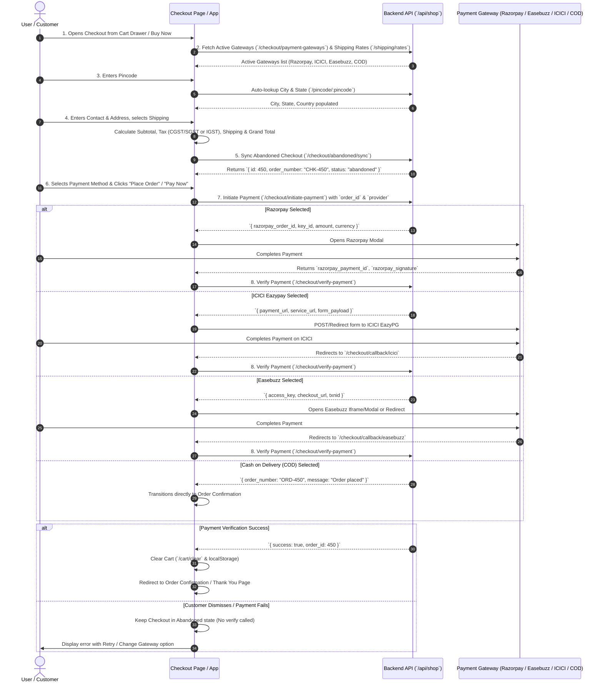

# Complete Checkout & Multi-Payment Gateway Implementation Plan

> **Target Project**: Nilkanth Store (`new-nilkanthstore`)  
> **API Specs**: [checkout.md](file:///c:/Users/admin/Desktop/New%20folder%20(4)/new-nilkanthstore/checkout.md) & [api.md](file:///c:/Users/admin/Desktop/New%20folder%20(4)/new-nilkanthstore/api.md)  
> **Status**: Ready for Implementation  

---

## 1. System Architecture & Complete Flow



---

## 2. API Services Layer Implementation (`src/services/api.js`)

We will expand [src/services/api.js](file:///c:/Users/admin/Desktop/New%20folder%20(4)/new-nilkanthstore/src/services/api.js) to include all dedicated endpoints from `checkout.md` and `api.md`:

### 2.1 Pincode Auto-Lookup
- **Endpoint**: `GET /pincode/:pincode`
- **Purpose**: Auto-populates city, state, and country as soon as the user enters a 6-digit Indian PIN code.
- **Function**: `fetchPincodeDetails(pincode)`

### 2.2 Payment Gateways
- **Endpoint**: `GET /checkout/payment-gateways`
- **Purpose**: Fetches currently active gateways (Razorpay, ICICI, Easebuzz, COD) and their public credentials/metadata.
- **Function**: `fetchPaymentGateways()`

### 2.3 Shipping Rates
- **Endpoint**: `POST /shipping/rates`
- **Purpose**: Dynamic delivery method rates, free shipping thresholds, and estimated transit times calculated based on destination address, subtotal, and cart items.
- **Function**: `fetchShippingRates({ address, order_amount, items })`
- **Payload Structure**:
  ```json
  {
    "address": {
      "country": "India",
      "state": "Maharashtra",
      "pincode": "400001",
      "city": "Mumbai"
    },
    "order_amount": 1998.00,
    "items": [
      {
        "variant_id": 34,
        "quantity": 2
      }
    ]
  }
  ```

### 2.4 Abandoned Checkout Sync
- **Endpoint**: `POST /checkout/abandoned/sync`
- **Purpose**: Saves checkout progress when customer reaches Step 1/Step 2. Enables recovery of dropped sessions.
- **Function**: `syncAbandonedCheckout(payload)`
- **Payload Structure**:
  ```json
  {
    "sessionId": "session_chk_1730000000_abc123",
    "customer": {
      "name": "Rahul Sharma",
      "phone": "+919876543210",
      "email": "rahul.sharma@example.com"
    },
    "shipping_address": {
      "address1": "Flat 402, Sunshine Heights",
      "address2": "MG Road",
      "city": "Mumbai",
      "state": "Maharashtra",
      "pincode": "400001",
      "country": "India"
    },
    "items": [
      {
        "productId": 12,
        "variantId": 34,
        "title": "Premium Silk Scarf",
        "price": 999.00,
        "quantity": 2
      }
    ],
    "subtotal": 1998.00,
    "discount": 0.00,
    "shipping": 100.00,
    "tax": 99.90,
    "tax_lines": [
      { "name": "CGST", "rate": 2.5, "amount": 49.95 },
      { "name": "SGST", "rate": 2.5, "amount": 49.95 }
    ],
    "total": 2197.90,
    "currency": "INR",
    "utm_source": "direct",
    "device_type": "desktop"
  }
  ```

### 2.5 Initiate Payment
- **Endpoint**: `POST /checkout/initiate-payment`
- **Purpose**: Generates gateway session tokens/orders (Razorpay Order ID, ICICI form payload, Easebuzz access key, or COD order).
- **Function**: `initiatePayment({ order_id, provider, return_url, customer })`

### 2.6 Verify Payment
- **Endpoint**: `POST /checkout/verify-payment`
- **Purpose**: Verifies gateway payment signature/tokens and transitions order status to `paid`.
- **Function**: `verifyPayment(payload)`

### 2.7 Order Tracking & Details
- **Endpoint**: `GET /orders/:id`
- **Purpose**: Fetches settled order invoice and fulfillment data for the Thank You page.
- **Function**: `fetchOrderDetails(orderId)`

---

## 3. Component Architecture & UI Flow

We will build modular, high-aesthetic components following the sacred devotional luxury theme:

```
src/
├── components/
│   ├── checkout/
│   │   ├── CheckoutPage.jsx            # Main Container & State Coordinator
│   │   ├── CheckoutCustomerStep.jsx    # Contact Info, Login Toggle, Guest Mode
│   │   ├── CheckoutShippingStep.jsx    # Address, Pincode Auto-Lookup, Delivery Options
│   │   ├── CheckoutPaymentStep.jsx     # Payment Gateway Selection & Gateway Modals
│   │   ├── CheckoutSummary.jsx         # Sticky Order Summary, Promo, Tax Breakdown
│   │   ├── CheckoutSuccessPage.jsx     # Order Confirmation / Thank You Page
│   │   └── GatewayCallbackPage.jsx     # Handles ICICI & Easebuzz Return Redirects
│   ├── CartDrawer.jsx                  # Updated with seamless "Proceed to Checkout"
```

---

## 4. Multi-Payment Gateway Integration Details

### 4.1 Razorpay Checkout Integration
1. Dynamically load script `https://checkout.razorpay.com/v1/checkout.js`.
2. Upon initiating payment, receive `razorpay_order_id`, `key_id`, `amount`, and `customer` details.
3. Open `new window.Razorpay(options)`:
   - **`handler` callback**: Calls `verifyPayment({ provider: "razorpay", order_id, payment_id, razorpay_order_id, razorpay_payment_id, razorpay_signature })`.
   - **`modal.ondismiss` callback**: Handles user cancellation gracefully without creating a paid order.

### 4.2 Easebuzz Checkout Integration
1. Dynamically load Easebuzz script `https://ebz-static.s3.ap-south-1.amazonaws.com/easecheckout/easebuzz-checkout.js`.
2. Call `initiatePayment({ order_id, provider: "easebuzz", return_url })`.
3. Open Easebuzz modal with `access_key` or redirect to `checkout_url`.
4. Receive transaction callback -> verify with `verifyPayment({ provider: "easebuzz", ... })`.

### 4.3 ICICI Bank Eazypay Integration
1. Call `initiatePayment({ order_id, provider: "icici", return_url: window.location.origin + "/checkout/callback/icici" })`.
2. Create an auto-submitting hidden HTML form targeting `service_url` with encrypted fields from `form_payload`.
3. The customer completes payment on ICICI EazyPG and is redirected back to `/checkout/callback/icici`.
4. The callback page extracts URL params and sends them to `/checkout/verify-payment`.

### 4.4 Cash on Delivery (COD)
1. Check min/max order amount rules from `metadata` (e.g. max ₹50,000).
2. Call `initiatePayment({ order_id, provider: "cod" })`.
3. Immediately transitions the session to order placed (`financial_status: 'pending'`).

---

## 5. Tax & Shipping Calculation Rules

### 5.1 Tax Engine (India GST)
- **Intra-state (e.g., Gujarat to Gujarat)**:
  - CGST: 1.5%
  - SGST: 1.5%
  - Total GST: 3% (Standard jewelry rate or configurable per store policy)
- **Inter-state (e.g., Gujarat to Maharashtra/other states)**:
  - IGST: 3.0%
- Calculates detailed `tax_lines` array for compliance with invoice requirements.

### 5.2 Dynamic Shipping Calculation
- Free Shipping threshold (e.g., Orders above ₹999 get Free Express Shipping).
- Standard / Express Delivery rate selection.
- Clear delivery ETA estimation badges (3-5 business days across India).

---

## 6. Abandoned Checkout Recovery Engine

1. **Session Generation**: A unique `sessionId` (`session_chk_<timestamp>_<random>`) is generated upon opening checkout.
2. **Debounced Sync**: When the user enters their email/phone or fills the shipping address, a debounced sync request sends the cart snapshot to `/checkout/abandoned/sync`.
3. **Step Progression Sync**: Whenever user clicks "Proceed to Payment", the order is created in `status: 'abandoned'`.
4. **Resilience**: If the user drops off, closes tab, or cancels payment, store admins have the complete cart, contact info, and items for WhatsApp/Email abandoned recovery campaigns.

---

## 7. Implementation Steps & Checklist

- [ ] **Step 1: API Services Setup**
  - Implement `fetchPaymentGateways`, `fetchPincodeDetails`, `fetchShippingRates`, `syncAbandonedCheckout`, `initiatePayment`, `verifyPayment`, `fetchOrderDetails` in `src/services/api.js`.

- [ ] **Step 2: Routing & URL Navigation in App.jsx**
  - Add routes: `/checkout`, `/checkout/success`, `/checkout/callback/icici`, `/checkout/callback/easebuzz`.
  - Connect Cart Drawer "Proceed to Checkout" and Product Page "Buy Now" directly to `/checkout`.

- [ ] **Step 3: Build Core Checkout Components**
  - Build `CheckoutPage.jsx` with full state management, step stepper, trust badges, and coupon handling.
  - Build `CheckoutCustomerStep.jsx` (guest email/phone or logged-in address picker).
  - Build `CheckoutShippingStep.jsx` with automatic PIN code lookup, state detection, and address validation.
  - Build `CheckoutPaymentStep.jsx` with live gateway cards (Razorpay, ICICI, Easebuzz, COD), security badges, and dynamic charges.
  - Build `CheckoutSummary.jsx` showing order items, subtotal, discount, shipping, CGST/SGST/IGST breakdown, and grand total.

- [ ] **Step 4: Payment Gateway SDKs & Verification Flow**
  - Embed Razorpay & Easebuzz SDK triggers.
  - Setup form POST redirection for ICICI Eazypay.
  - Setup instant placement for COD.
  - Add verification handler with error boundaries and retry logic.

- [ ] **Step 5: Order Confirmation & Thank You Screen**
  - Build `CheckoutSuccessPage.jsx` displaying Order ID (`ORD-...` / `CHK-...`), payment status, shipping address, invoice download button, delivery timeline, and WhatsApp customer support link.

- [ ] **Step 6: Testing & Quality Assurance**
  - Test guest checkout vs logged-in checkout.
  - Test PIN code auto-fill (e.g., `380001` -> Ahmedabad, Gujarat).
  - Test tax line calculations (intra-state CGST+SGST vs inter-state IGST).
  - Test Razorpay test mode payment verification.
  - Test COD order placement.
  - Test modal dismissal to confirm abandoned cart state retention.
